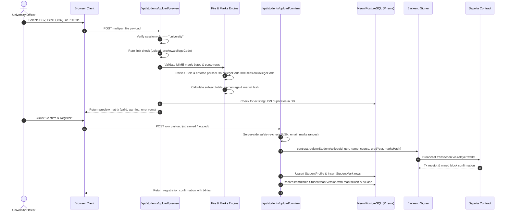
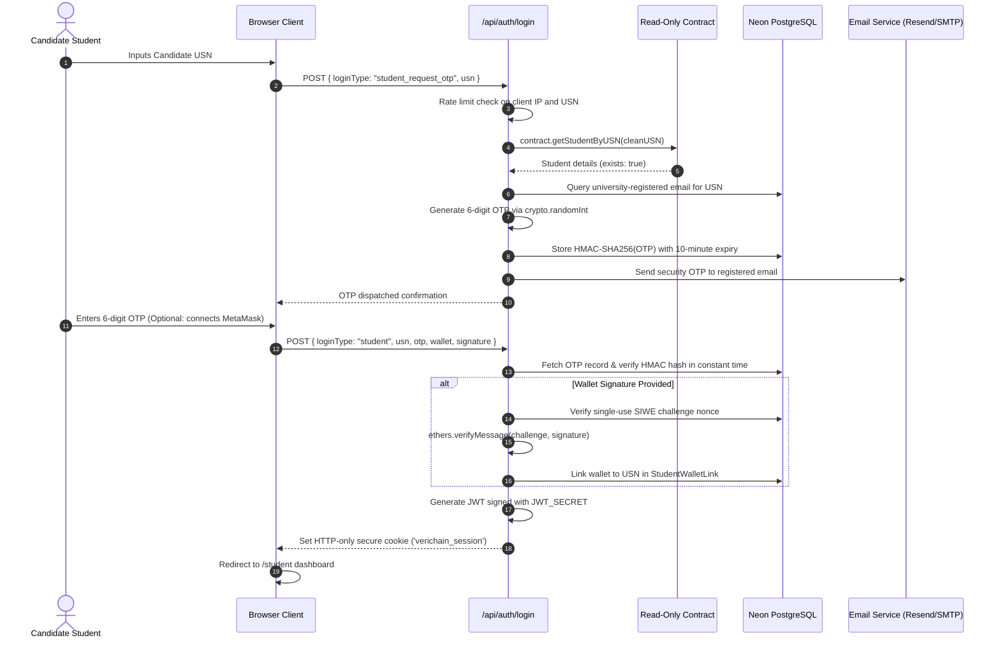
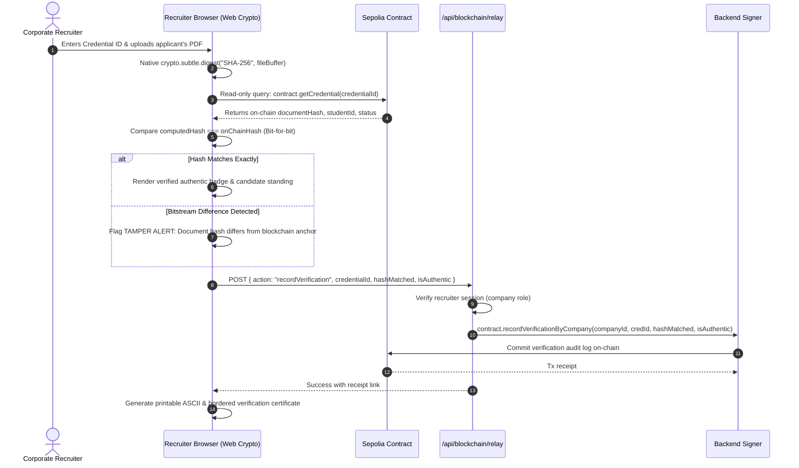

# VeriChain System Architecture & Request Lifecycle

This document provides a comprehensive technical overview of the **VeriChain** decentralized document and marks verification platform. It details the structural components, data boundaries, communication protocols, and step-by-step request lifecycles across the application.

---

## 1. High-Level Component Topology

VeriChain implements a modern **hybrid Web2/Web3 architecture**. It leverages the performance and privacy of serverless relational storage alongside the immutability and decentralized trust of the Ethereum blockchain.

```
+---------------------------------------------------------------------------------------------------+
|                                      CLIENT BROWSER LAYER                                         |
|                                                                                                   |
|  +--------------------+   +---------------------+   +--------------------+   +-----------------+  |
|  |  University Admin  |   | Candidate (Student) |   | Corporate Recruiter|   | Public Auditor  |  |
|  |  Portal (/univ)    |   | Digital Locker      |   | Terminal (/company)|   | (/verify)       |  |
|  +---------+----------+   +----------+----------+   +---------+----------+   +--------+--------+  |
|            |                         |                        |                       |           |
|            +-------------------------+-----------+------------+-----------------------+           |
|                                                  |                                                |
|                                          HTTPS / REST / JSON                                      |
+--------------------------------------------------+------------------------------------------------+
                                                   |
                                                   v
+---------------------------------------------------------------------------------------------------+
|                               NEXT.JS SERVERLESS APPLICATION LAYER                                |
|                                                                                                   |
|  +---------------------------------------------------------------------------------------------+  |
|  | Route Handlers (app/api/)                                                                   |  |
|  | - /api/auth/login               (Rate-limited SIWE, bcrypt access code, and HMAC OTP)       |  |
|  | - /api/students/upload/preview  (MIME/magic-byte checks, USN parser, in-batch duplicate checks)|  |
|  | - /api/students/upload/confirm  (Marks limits, DB collision checks, Keccak-256 marksHash)  |  |
|  | - /api/achievements             (College queue isolation, portfolio endorsement)           |  |
|  | - /api/blockchain/relay         (Gasless transaction signer with 'onlyRelayer' modifier)    |  |
|  | - /api/ipfs/upload              (Pinata IPFS pinning gateway)                               |  |
|  +-----------------------------------------------+---------------------------------------------+  |
|                                                  |                                                |
|            +-------------------------------------+-----------------------------------+            |
|            |                                                                         |            |
|            v                                                                         v            |
|  +-------------------------------+                                         +-------------------+  |
|  | Server-Side Security Core     |                                         | Ethers.js v6      |  |
|  | - JWT Session Engine (jose)   |                                         | Relayer Engine    |  |
|  | - USN Parser & College Binder |                                         | - Nonce Tracker   |  |
|  | - Marks Evaluation Engine     |                                         | - Gas Estimator   |  |
|  | - Distributed Rate Limiter    |                                         | - Server Signer   |  |
|  +---------------+---------------+                                         +---------+---------+  |
+------------------|-------------------------------------------------------------------|------------+
                   |                                                                   |
                   | Prisma ORM (Pooled TLS)                                           | JSON-RPC
                   v                                                                   v
+--------------------------------------+                             +------------------------------+
|     POSTGRESQL RELATIONAL DB         |                             |     ETHEREUM BLOCKCHAIN      |
|           (Neon / Supabase)          |                             |     (Sepolia / Hardhat)      |
|                                      |                             |                              |
| - StudentProfile & StudentMark       |                             | ITHiringMarksVerification    |
| - StudentMarkVersion (History)       |                             | - University & Company Registry
| - StudentAchievement                 |                             | - Student Registry (marksHash)
| - InstitutionCredential (bcrypt)     |                             | - Credential Ledger (DocHash)
| - AuthNonce & RateLimitCounter       |                             | - Verification Audit Trail   |
+--------------------------------------+                             +------------------------------+
                                                                                    ^
                                                                                    | Content Hash
                                                                                    v
                                                                     +------------------------------+
                                                                     |     DECENTRALIZED STORAGE    |
                                                                     |         (Pinata IPFS)        |
                                                                     |                              |
                                                                     | - Content-Addressed PDFs     |
                                                                     | - Academic Marksheets        |
                                                                     | - Encrypted Credentials     |
                                                                     +------------------------------+
```

---

## 2. Core Architectural Components

### A. Next.js 14 Presentation & Route Layer
- **App Router Framework**: Built with modern Server and Client Components.
- **Role-Based Portals**:
  - `/university`: Onboarding students, subject-wise marks management, multi-format upload preview, credential issuance, and achievement review.
  - `/student`: Passwordless candidate digital locker, academic records view, QR verification code generator, and achievement upload.
  - `/company`: Corporate recruiter terminal with Mode 1 (enrollment status) and Mode 2 (cryptographic tamper audit) engines, producing official printable verification receipts.
  - `/admin-login` & `/admin`: Restricted platform governance console protected by contract deployer wallet authentication.
  - `/verify` & `/verify/[credentialId]`: Public verification search engine.
- **Process Steppers**: Real-time progress trackers mounted at the top of each dashboard driven by active session and on-chain state.

### B. Gasless Transaction Relayer Layer
In typical decentralized applications, end users must hold native cryptocurrency (e.g. Sepolia ETH) to pay gas fees for every write operation. This creates massive friction for university staff and recruiters.

**VeriChain eliminates gas barriers through an Authorized Relayer Pattern**:
1. All client write operations send authenticated requests to the internal Next.js API (`/api/blockchain/relay` or `/api/students/upload/confirm`).
2. The server verifies user identity, role privileges, and college binding.
3. The server signer ([`lib/serverContract.ts`](file:///c:/Users/dhany/Desktop/Project/lib/serverContract.ts)) signs and broadcasts the Ethereum transaction using its funded relayer key.
4. The smart contract validates that `msg.sender == authorizedRelayer` via the `onlyRelayerOrAdmin` modifier.
5. Gas fees are sponsored centrally by the platform authority, offering users a Web2-like user experience with Web3 trust guarantees.

### C. Neon Serverless PostgreSQL & Prisma ORM
- Provides ACID-compliant relational storage for high-frequency queries, audit versions, and private candidate details.
- Leverages Neon serverless connection pooling to withstand concurrent serverless function invocations without exhausting database connection pools.
- **Database Schema Models**:
  - `StudentProfile`: USN, student name, official email, degree course, graduation year, cumulative totals, current `marksVersion`, and on-chain `marksHash`.
  - `StudentMark`: Normalized subject-level marks breakdown per student, semester, subject code, internal/external splits, max marks, and grades.
  - `StudentMarkVersion`: Immutable audit log of every revision, tracking marks totals, computed Keccak-256 hashes, modifying college identity, and transaction hashes.
  - `StudentAchievement`: Candidate-uploaded credentials, IPFS CIDs, document hashes, and endorsing college review statuses.
  - `InstitutionCredential`: Bcrypt-hashed access passkeys for institutional logins.
  - `StudentWalletLink`: Strict 1-to-1 mappings between verified USNs and Ethereum addresses.
  - `AuthNonce` & `RateLimitCounter`: Ephemeral tables providing distributed brute-force protection and replay prevention across serverless instances.

### D. Ethereum Smart Contract Layer (`ITHiringMarksVerification.sol`)
- Deployed on **Ethereum Sepolia Testnet** (or local Hardhat EVM at `0x5FbDB2315678afecb367f032d93F642f64180aa3`).
- **Core Responsibilities**:
  - Institutional accreditation state (active/suspended colleges and companies).
  - Student registration binding candidate USN to their college ID and `marksHash`.
  - Credential minting: Anchoring 32-byte SHA-256 document fingerprints, IPFS CIDs, and document types.
  - 4-Stage Credential Lifecycle: `Active (0)`, `Revoked (1)`, `Suspended (2)`, `Expired (3)`.
  - Student Achievement endorsement records.
  - Permanent, immutable relational verification logs (`recordVerificationByCompany`).

### E. Decentralized IPFS Storage Layer (Pinata)
- Official marksheet documents, degree certificates, and student portfolio files are pinned to IPFS.
- Content addressing guarantees that if a file is tampered with by even a single bit, its resulting Content Identifier (CID) changes completely.
- Documents can be encrypted client-side using AES-256-GCM prior to pinning for maximum candidate confidentiality.

---

## 3. End-to-End Request Lifecycles

### Flow 1: Bulk Student Marks Upload & Blockchain Anchor



---

### Flow 2: Passwordless Student Authentication (OTP & SIWE)



---

### Flow 3: Mode 2 Deep Cryptographic Tamper Audit


